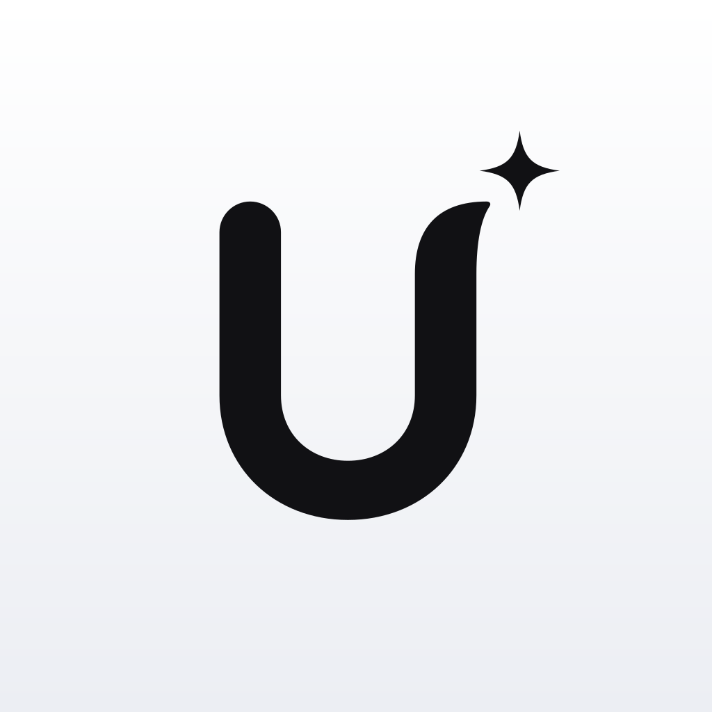
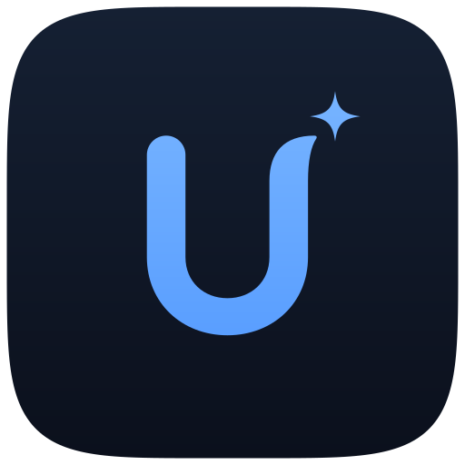

<div align="center">


# UniApp

**La tua carriera universitaria, in un unico posto.**
<br />
Esperienza nativa multipiattaforma per gli studenti dell'Università degli Studi del Molise, sviluppata con **Kotlin Multiplatform**, **Compose Multiplatform** e **Liquid Monet**.

<p>
  <a href="https://anto426-project.github.io/uniapp-upstream/"></a>
  
  
  
  
</p>

<p>
  <a href="#funzionalità">Funzionalità</a> ·
  <a href="#identità-visiva">Identità visiva</a> ·
  <a href="#architettura-e-sdk">Architettura e SDK</a> ·
  <a href="#avvio-rapido">Avvio rapido</a> ·
  <a href="#documentazione">Documentazione</a>
</p>

</div>

---

## Funzionalità

UniApp riunisce i servizi accademici quotidiani in un'interfaccia fluida, curata nei dettagli e progettata intorno al design system **Liquid Monet**:

<table>
  <tr>
    <td width="50%" valign="top">
      <h3>Carriera e Libretto</h3>
      Monitoraggio completo di esami sostenuti, CFU, medie ponderate e aritmetiche, proiezioni di laurea e statistiche avanzate.
    </td>
    <td width="50%" valign="top">
      <h3>Appelli e Didattica</h3>
      Consultazione degli appelli, prenotazione e gestione esami, schede insegnamento con programmi strutturati, docenti e link diretti ai portali ufficiali.
    </td>
  </tr>
  <tr>
    <td width="50%" valign="top">
      <h3>Badge Universitario e Biglietti</h3>
      Tessera studente interattiva 3D con QR code generato nativamente, supporto al salvataggio e alla lettura rapida dei titoli di viaggio.
    </td>
    <td width="50%" valign="top">
      <h3>Trasporti e Servizi</h3>
      Prenotazione e cancellazione delle navette universitarie, gestione tasse, questionari didattici multi-pagina e notifiche push.
    </td>
  </tr>
  <tr>
    <td width="50%" valign="top">
      <h3>Sicurezza Biometrica e PIN</h3>
      Blocco sessione con autenticazione biometrica e PIN a 6 cifre, credenziali protette tramite storage crittografato multipiattaforma.
    </td>
    <td width="50%" valign="top">
      <h3>Liquid Monet e Material You</h3>
      Superfici optical glass, palette dinamiche Monet, icone adattive Android 13+, varianti iOS Dark/Tinted e transizioni unificate con supporto a <em>Riduci movimento</em>.
    </td>
  </tr>
</table>

---

## Identità visiva

Il marchio **Apple Spark U** vive in [`assets/icon/`](./assets/icon/README.md) con sorgenti vettoriali pure e tutte le esportazioni pronte per Android, Android Monet, iOS (`AppIcon.appiconset` + Appearances + Icon Composer), Google Play Store, App Store e Web.

<div align="center">
  <table>
    <tr>
      <td align="center" width="140">
        <br />
        <sub><strong>Default Dark</strong></sub>
      </td>
      <td align="center" width="140">
        <br />
        <sub><strong>Light</strong></sub>
      </td>
      <td align="center" width="140">
        <br />
        <sub><strong>Android Monet</strong></sub>
      </td>
      <td align="center" width="140">
        <br />
        <sub><strong>iOS Tinted</strong></sub>
      </td>
    </tr>
  </table>
</div>

---

## Stack Tecnologico

| Area | Tecnologie |
| --- | --- |
| **Linguaggio & Core** | Kotlin `2.4.21` · Coroutines `1.11.0` · Serialization `1.13.0` · DateTime `0.8.0` |
| **UI & Navigazione** | Compose Multiplatform `1.12.2` · Material 3 · Navigation 3 `1.2.0` · Coil 3 `3.6.3` |
| **Networking & Codici** | Ktor `3.6.1` (OkHttp / Darwin) · ZScanner · QRose · ZXing |
| **Piattaforme** | Android (`minSdk 29`, `targetSdk 37`, AGP `9.5.2`) · iOS (`arm64`, `simulatorArm64`) |
| **Web & Distribuzione** | Next.js (`website/`) · GitHub Actions indipendenti per Android, iOS e Sito |

---

## Architettura e SDK

UniApp separa le fondamenta tecniche in **SDK precompilati indipendenti**, risolti per versione esplicita dal catalogo [`gradle/libs.versions.toml`](./gradle/libs.versions.toml) con verifica integrità SHA-256 in `.sdk-binaries/maven`:

| SDK | Versione | Responsabilità | Repository |
| --- | --- | --- | --- |
| **`liquid-monet`** | `2.0.56` | Componenti Compose, tema Monet, fisica e superfici optical glass | [Anto426-Project/Liquid-Monet](https://github.com/Anto426-Project/Liquid-Monet) |
| **`uni-sdk`** | `2.0.37` | Client KMP per API Cineca, backend UniApp, trasporti e aggiornamenti | Modulo privato |
| **`secure-storage-sdk`** | `1.0.17` | Persistenza sicura multipiattaforma per credenziali e token | Modulo privato |
| **`firebase-connector-sdk`** | `1.0.11` | Push notification e integrazione Firebase / FCM | Modulo privato |

### Motion & UI Ownership
`AppNavigationHost` centralizza la transizione globale Liquid Monet su pagine e sottopagine (`DirectionalHorizontal` come preset predefinito, personalizzabile in *Tema → Sfondo, fisica e animazioni* con pieno rispetto di *Riduci movimento*). Lo script `python3 scripts/checks/check_motion_ownership.py` garantisce che le schermate non introducano animazioni locali incoerenti.

---

## Avvio rapido

### Prerequisiti
- **JDK 21** e **Python 3.11+**
- Credenziali GitHub con accesso in lettura agli SDK (`GITHUB_TOKEN`, `GH_TOKEN`, `gh auth login` oppure Git Credential Manager)

### Scaricare gli SDK e compilare

```sh
# 1. Scarica e verifica gli archivi Maven degli SDK dichiarati nel catalogo
python3 scripts/sdk/fetch_sdk_binaries.py

# 2. Esegui test host e compila l'APK debug Android
./gradlew :composeApp:testAndroidHostTest :androidApp:assembleDebug

# 3. Esegui test release, stringhe e policy di motion ownership
python3 scripts/checks/validate_release.py
```

Per aggiornare uno SDK è sufficiente modificare la sua versione nella sezione `[versions]` di [`gradle/libs.versions.toml`](./gradle/libs.versions.toml) e rieseguire `python3 scripts/sdk/fetch_sdk_binaries.py`.

---

## Struttura del repository

```text
androidApp/        Entry point Android, manifest, tema e ProGuard/R8
composeApp/        Codice condiviso Kotlin & Compose Multiplatform
  src/commonMain/  UI, stato, navigazione e logica condivisa
  src/androidMain/ Integrazioni native e risorse Android (adaptive icon & Monet)
  src/iosMain/     Integrazioni native iOS
iosApp/            Host application Xcode e catalogo AppIcon (Default, Dark, Tinted)
assets/icon/       Kit completo icone (SVG, Android, Monet, iOS, Play Store, App Store, Web)
website/           Sito web ufficiale e pagina di distribuzione
scripts/           Script riorganizzati per dominio (sdk/, checks/, release/, tests/)
docs/              Documentazione tecnica e guide build
```

---

## Documentazione

- [Dipendenze e guida alle build](./docs/build-dependencies.md) — toolchain, runner CI, integrazione Xcode e gestione degli SDK
- [Workflow di build e pubblicazione](./docs/build-workflows.md) — pipeline Android, iOS e distribuzione indipendente
- [Badge e biglietti](./docs/codes-and-tickets.md) — generazione artistica dei codici, lettura e conservazione degli originali
- [Segnalazioni e feedback](./docs/github-feedback.md) — come aprire bug report, proposte e contributi
- [Kit icone e brand](./assets/icon/README.md) — inventario completo dei formati vettoriali e raster
- [Guida agli script](./scripts/README.md) — organizzazione e comandi di `scripts/`

---

<div align="center">
  <sub>
    Sviluppata e mantenuta in modo indipendente da <strong>Anto426</strong>.<br />
    UniApp non è affiliata ufficialmente all'Università degli Studi del Molise.
  </sub>
</div>
